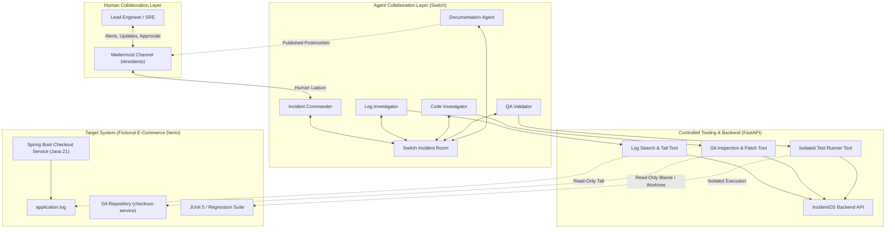

# IncidentOS

> **A Multi-Agent AI Incident Response Platform**  
> Built for real-world collaborative incident investigation, evidence verification, regression-tested remediation, and postmortem generation through Switch and Mattermost.

---

## 1. Overview & Vision

During software outages, engineering teams face cognitive overload, manual log trawling, disparate communication channels, and hallucinated or unverified AI advice. **IncidentOS** changes this by deploying a coordinated team of five specialized AI agents that collaborate in real time over **Switch** and interface with human engineers directly via **Mattermost**.

IncidentOS is built as a **working, empirical product**—not a scripted mock or canned demo. Every finding is tied to real log lines or Git commits, every remediation is executed on an isolated Git branch, every fix is validated with actual test runs, and every remediation requires **mandatory human approval** before documentation and post-incident closure.

---

## 2. Core Architecture

IncidentOS unites three distinct collaboration and execution layers:



> [!NOTE]
> **Tool Authorization & Switch Integration Boundary**:
> Tool invocations enforce strict least privilege. In accordance with [ADR-011](docs/DESIGN_DECISIONS.md#adr-011-do-not-automate-switch-approvals-without-structured-tool-provenance), automated approval based on Switch display-title string matching is explicitly rejected because the Switch 0.31.0 wire event omits structured tool/server provenance, creating title-spoofing risks. All non-autonomous actions remain gated behind authenticated human review.

---

## 3. The Five Specialized Agents

| Agent | Surface | Primary Responsibility | Critical Boundary |
| :--- | :--- | :--- | :--- |
| **Incident Commander** | Mattermost & Switch | Receives alert, triages severity, formulates investigation plan, coordinates agents via Switch, synthesizes RCA, requests human approval. | Cannot run tools directly; cannot approve remediation. |
| **Log Investigator** | Switch | Analyzes raw application logs, identifies stack traces, error frequencies, and affected endpoints. | Read-only access to log paths only; no code access. |
| **Code Investigator** | Switch | Inspects source code, Git history, commit diffs, and blames; develops isolated fix patch. | Read-only code inspection; write access strictly on isolated fix branches. |
| **QA & Validation Agent** | Switch | Executes automated regression tests against the fix branch; captures execution results. | Execution strictly sandboxed; cannot modify production code. |
| **Documentation Agent** | Switch & Mattermost | **Dormant until human approval.** Collects timeline, evidence, diff, and test run results; generates audit-ready postmortem. | Cannot run before human approval; never fabricates data. |

---

## 4. Demo Scenario

IncidentOS is demonstrated using a fictional **e-commerce checkout service** (`checkout-service`) written in **Java 21** and **Spring Boot**:

1. A recent release commit introduces a regression in `PaymentValidator.validate()`.
2. The checkout endpoint (`POST /api/checkout`) begins throwing `HTTP 500` errors due to a `NullPointerException` when processing guest or unregistered customer payloads.
3. The Log Investigator identifies the NPE stack trace and affected endpoint.
4. The Code Investigator traces the commit that removed the null check and prepares an isolated fix branch (`remediation/issue-checkout-npe`).
5. The QA Agent runs the test suite on the fix branch, confirming the regression test passes and no existing tests break.
6. The Incident Commander presents the diagnosis and test results to the human engineer in Mattermost and requests explicit approval.
7. Upon human approval, the Documentation Agent generates a comprehensive, factual Markdown postmortem and posts it directly to Mattermost.

---

## 5. Repository Structure

```
.
├── AGENTS.md                  # Comprehensive operational contracts for all 5 agents
├── README.md                  # Project overview, architecture, and quickstart (this file)
├── .gitignore                 # VCS ignore patterns
├── .env.example               # Environment configuration template
├── docs/
│   ├── PRD.md                 # Product Requirements Document
│   ├── ARCHITECTURE.md        # Technical architecture, protocols, and data flows
│   ├── REQUIREMENTS.md        # Detailed functional & non-functional requirements
│   ├── SECURITY.md            # Security, sandboxing, and least-privilege policies
│   ├── IMPLEMENTATION_PLAN.md # 9-milestone implementation plan
│   ├── DEMO_GUIDE.md          # Step-by-step presentation script & verification guide
│   └── DESIGN_DECISIONS.md    # Architectural Decision Records (ADRs) & unknown integration details
├── agents/                    # Agent-specific definitions & prompt configurations
│   ├── commander/             # Incident Commander agent specification
│   ├── log-investigator/      # Log Investigator agent specification
│   ├── code-investigator/     # Code Investigator agent specification
│   ├── qa-validator/          # QA & Validation agent specification
│   └── documentation/         # Documentation agent specification
├── backend/                   # IncidentOS Python/FastAPI backend & controlled tools
├── demo-environment/          # Fictional Java 21 / Spring Boot checkout service
├── mcp-server/                # FastMCP stdio server exposing IncidentOS tools to agents
└── switch/                    # Switch agent collaboration configuration & bindings
```

---

## 6. Quickstart & Verification

### Prerequisites
- **Python**: `>=3.12`
- **Java**: Java 21 (e.g. `openjdk@21` for checkout-service compilation and runner execution)
- **Node.js**: Node 20+ (optional, for Switch Console runtime)

### Installation
Set up the Python environment and install both backend and FastMCP dependencies:

```bash
# 1. Create and activate virtual environment
python3.12 -m venv backend/.venv
source backend/.venv/bin/activate

# 2. Install backend and test dependencies
pip install -e "./backend[dev]"

# 3. Install FastMCP server and dependencies
pip install -e "./mcp-server[dev]"
```

### Environment Configuration
Configure local credentials from the template:
```bash
cp .env.example backend/.env
```
Ensure `backend/.env` contains a secure random token for `INCIDENTOS_API_TOKEN` (e.g., `incidentos-dev-token-local`).
> [!IMPORTANT]
> Never commit `.env` or live credentials to version control. All `.env` files are excluded by `.gitignore`.

### Running Verification Tests

Run the full automated test suites:

```bash
# Execute backend tool & security test suite (79 tests)
pytest backend/tests

# Execute FastMCP tool & protocol test suite (20 tests)
pytest mcp-server/tests
```

### Starting the Controlled Backend Tools Service

Start the local sandboxed FastAPI service:
```bash
PYTHONPATH=backend uvicorn app.main:app --host 127.0.0.1 --port 8000 --env-file backend/.env
```

The service is available locally:
- **Base API URL**: `http://127.0.0.1:8000`
- **Health Check**: `http://127.0.0.1:8000/health`
- **Interactive OpenAPI Docs**: `http://127.0.0.1:8000/docs`

---

## 7. Implementation Milestones

1. **Milestone 1**: Multi-Agent Collaboration Foundation (Switch & Mattermost setup)
2. **Milestone 2**: Establishing 5 Independent Agent Sessions
3. **Milestone 3**: Reproducible Incident in Spring Boot Demo App
4. **Milestone 4**: Controlled Backend Investigation Tools (FastAPI)
5. **Milestone 5**: Evidence-Backed Root Cause Analysis Workflow
6. **Milestone 6**: Proposed Remediation & Regression Testing Workflow
7. **Milestone 7**: Interactive Human Approval Gate
8. **Milestone 8**: Post-Approval Postmortem Generation
9. **Milestone 9**: End-to-End Rehearsal & Live Demonstration

---

## 8. Security & Engineering Rules

- **Zero Hallucination**: Every assertion must link to verifiable logs, diffs, or test runs.
- **Strict Role Boundaries**: Agents have isolated scopes and least-privilege toolsets.
- **Read-Only First**: Triage and initial investigation are non-destructive and read-only.
- **Mandatory Human Approval**: No fix is ever merged or deployed autonomously.
- **Sanitized Tool Inputs**: All path parameters are validated and locked to the workspace jail.
