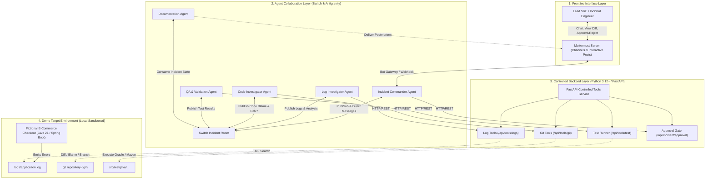
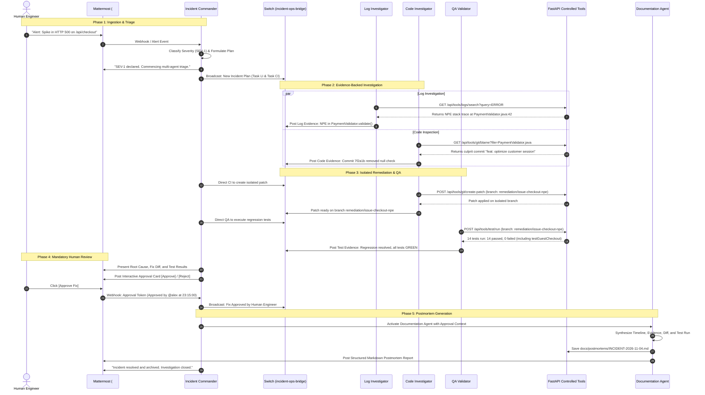

# System Architecture Specification

## Project: IncidentOS
**Document**: Technical Architecture & System Design  
**Status**: Initial Architecture / Approved for Initialization  

---

## 1. Architectural Philosophy

IncidentOS is designed around three foundational architectural choices:

1. **Separation of Collaboration Concerns**:
   - **Mattermost** serves as the **Human-in-the-Loop Interface**. Human operators need clean, high-signal alerts, structured summaries, and interactive decision buttons.
   - **Switch** serves as the **Inter-Agent Orchestration Fabric**. Autonomous agents need a fast, low-overhead shared room to exchange machine-readable findings, debate hypotheses, coordinate task handoffs, and synchronize state.
2. **Empirical Verification via Controlled Tools**:
   - Rather than granting agents broad bash access or unconstrained network capabilities, IncidentOS provides **strictly typed, validated, and sandboxed tools** through a lightweight FastAPI backend.
   - All tool arguments are validated with Pydantic; all filesystem accesses are constrained to a sandboxed workspace root; all git operations operate on isolated worktrees.
3. **Deterministic State Progression**:
   - The incident lifecycle moves through discrete, auditable states. Crucially, the transition from `PENDING_HUMAN_APPROVAL` to `APPROVED` requires a cryptographic or signed human interaction token before the Documentation Agent is unlocked.

---

## 2. High-Level Component Topology



---

## 3. Component Details

### 3.1 Mattermost Integration (Human Interface)
- **Role**: Primary communication hub for the human engineer.
- **Interactions**:
  - Receives initial incident alert notification.
  - Receives regular, high-level status digests from the Incident Commander.
  - Renders interactive approval cards containing:
    - Root cause summary.
    - Culprit commit hash and author.
    - Unified Git diff of the proposed fix.
    - Verbatim test suite execution metrics (pass count, execution time).
    - **[Approve Fix]** and **[Reject Fix]** interactive action buttons.
  - Receives the final, complete Markdown postmortem published by the Documentation Agent.

### 3.2 Switch Collaboration Layer (Agent Fabric)
- **Role**: Agent-to-agent collaboration room and shared state broadcast.
- **Protocol**: Message-based event bus / chat room where each agent runs under an independent session identity.
- **Channel Schema**:
  - `incident-ops-bridge`: General room where the Incident Commander delegates tasks and agents post structured findings.
  - Task assignments are sent as structured JSON/Markdown directives.
  - Findings are returned with mandatory `evidence` fields (raw log snippets, commit hashes, unified diffs, test logs).

### 3.3 IncidentOS Backend & Controlled Tooling (FastAPI)
- **Role**: Sandboxed API gateway providing safe, parameterized tools to agents.
- **Key Modules**:
  1. `LogToolProvider`:
     - `tail_logs(file_path, lines=100)`: Reads the latest lines from a log file.
     - `search_logs(file_path, query, start_time, end_time)`: Filters log lines matching regex/keywords within a time boundary.
  2. `GitToolProvider`:
     - `inspect_commit_history(repo_path, max_count=10)`: Returns recent commits with authors and commit messages.
     - `get_blame(repo_path, file_path, line_range)`: Runs `git blame` for specific lines.
     - `create_remediation_branch(repo_path, base_branch, new_branch, patch)`: Safely creates an isolated branch and applies a remediation patch without touching `main`.
  3. `TestRunnerProvider`:
     - `execute_test_suite(repo_path, branch, test_filter)`: Runs `./gradlew test --tests <filter>` or `mvn test` in an isolated directory and returns parsed JUnit execution status, duration, and output.
  4. `IncidentStateManager`:
     - Tracks active incident state machine, immutable timeline entries, and human approval verification.

### 3.4 Target Demo Application (Spring Boot / Java 21)
- **Role**: Fictional microservice representing an e-commerce checkout service (`checkout-service`).
- **Structure**:
  - Standard Spring Boot 3.x project running on Java 21.
  - Key components:
    - `CheckoutController`: Handles `POST /api/checkout`.
    - `CheckoutService`: Coordinates checkout workflow.
    - `PaymentValidator`: Validates payment and customer identity.
  - **The Bug**:
    - A commit changes `PaymentValidator.java` to access `customer.getId()` without checking if `customer` is null (e.g. for guest checkout).
    - Unauthenticated guest checkout causes an unhandled `NullPointerException` returning HTTP 500.
  - **The Test Suite**:
    - JUnit 5 test suite containing existing unit tests plus a regression test `testGuestCheckout_ShouldSucceed()` that triggers the failure on the flawed code.

---

## 4. End-to-End Incident Lifecycle Sequence



---

## 5. State Machine & Incident Statuses

The incident progresses strictly through the following states managed by the IncidentOS Backend:

```
[REPORTED]
   │
   ▼
[TRIAGED] ────────────────────────── (Severity assigned, plan dispatched)
   │
   ▼
[INVESTIGATING] ──────────────────── (Log & Code agents gather empirical evidence)
   │
   ▼
[ROOT_CAUSE_IDENTIFIED] ──────────── (Commander synthesizes & confirms findings)
   │
   ▼
[REMEDIATION_PROPOSED] ───────────── (Isolated Git branch & patch prepared)
   │
   ▼
[QA_VALIDATED] ───────────────────── (Regression suite executed & verified GREEN)
   │
   ▼
[PENDING_HUMAN_APPROVAL] ─────────── (Interactive prompt waiting in Mattermost)
   │                       │
   │ (Approved)            │ (Rejected with feedback)
   ▼                       ▼
[APPROVED]           [REJECTED] ──► (Returns to REMEDIATION_PROPOSED)
   │
   ▼
[DOCUMENTED] ─────────────────────── (Documentation Agent generates postmortem)
   │
   ▼
[CLOSED]
```

---

## 6. Safety & Isolation Boundaries

1. **Workspace Boundary**: All backend tool invocations check canonical file paths to ensure they reside strictly within `ALLOWED_WORKSPACE_ROOT`. Any path containing `..` or pointing outside is rejected with `HTTP 403 Forbidden`.
2. **Read-Only Investigation**: All investigation endpoints are idempotent and read-only.
3. **Branch Isolation**: Changes are written only to a newly created Git branch prefixed with `remediation/`. The `main` branch is immutable to agents.
4. **Approval Enforcement**: The Documentation Agent and any downstream branch merging mechanisms require a valid, server-validated approval token signed by the human engineer's session.
