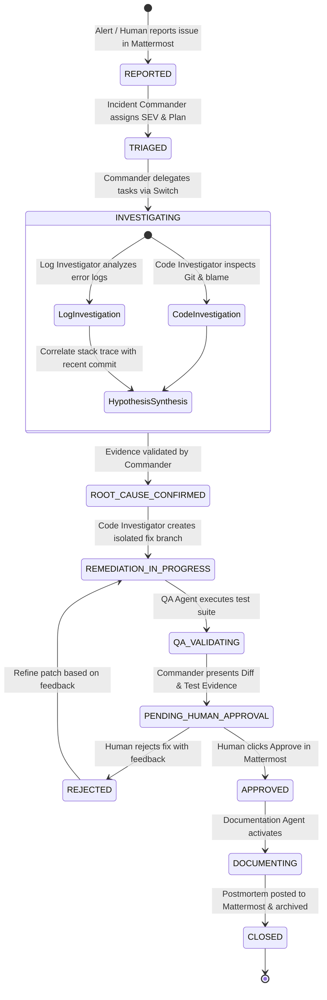

# Product Requirements Document (PRD)

## Project: IncidentOS
**Author**: Lead Software Architect  
**Status**: Initial Architecture / Approved for Initialization  
**Target Event**: Multi-Agent AI Hackathon  

---

## 1. Executive Summary

Incident response in modern engineering organizations is plagued by fragmented alerts, high cognitive load, manual error correlation, and uncoordinated communication across engineering teams. When AI assistants are introduced carelessly, they often hallucinate causes, fabricate log traces, or propose untested code modifications that risk causing second-order outages.

**IncidentOS** is a collaborative AI incident-response platform that pairs human engineers with five specialized AI agents. It leverages **Mattermost** as the command-and-control user interface for human engineers, and **Switch** as the inter-agent collaboration and orchestration fabric. IncidentOS emphasizes empirical investigation: agents inspect actual logs, navigate real Git commits, write isolated fixes, execute automated regression tests, and demand explicit human approval before any documentation or remediation is finalized.

---

## 2. Problem Statement & User Personas

### 2.1 The Problem
1. **Alert Fatigue & Triaging Bottlenecks**: Engineers waste valuable mean-time-to-resolution (MTTR) identifying the right logs and isolating recent code deployments.
2. **AI Hallucination & Lack of Auditability**: Standard LLM chat tools produce plausible-sounding code explanations that are ungrounded in real system telemetry.
3. **Unsafe Autonomous Actions**: Autonomous agents that directly commit or deploy to production risk catastrophic downtime without human guardrails.
4. **Postmortem Neglect**: SREs frequently fail to produce timely, high-fidelity postmortem documents due to tedious manual data compilation across chat, logs, and Git.

### 2.2 Target Personas
- **Alex (On-Call SRE / Incident Commander)**: Needs rapid triage, clear visibility into log failures, and structured task delegation without context switching between ten monitoring dashboards.
- **Priya (Backend Software Engineer)**: Needs to see the exact offending commit, a targeted diff explaining the bug, and confidence that proposed patches pass existing tests.
- **David (Engineering Director / Compliance Lead)**: Demands an immutable audit trail, mandatory human approval gates, and zero unverified autonomous changes to production systems.

---

## 3. Product Vision & Core Tenets

1. **Mattermost First**: The primary human interface is a Mattermost channel. The human engineer interacts naturally via chat and structured interactive messages.
2. **Switch Collaboration Layer**: Agents coordinate among themselves in a dedicated Switch room, challenging each other's hypotheses and sharing verified artifacts.
3. **Empirical Evidence Mandatory**: An agent cannot assert a root cause without citing specific log lines, timestamps, and commit hashes.
4. **Isolated Worktrees**: All code fixes are created on dedicated branches/worktrees and tested in sandbox isolation.
5. **Human Gatekeeper**: The human engineer is the ultimate decision maker. Human approval is mandatory before any remediation is accepted or postmortem published.
6. **No Phantom Postmortems**: The Documentation Agent is strictly dormant until human approval is recorded, preventing premature or fabricated summaries.

---

## 4. User Journey & Incident Lifecycle

---

## 5. Functional Requirements by Agent

### 5.1 Incident Commander Agent
- **FR-IC-01**: Ingest incident reports from Mattermost (alert title, description, symptoms).
- **FR-IC-02**: Classify severity (SEV-1 to SEV-4) and formulate a clear investigation plan.
- **FR-IC-03**: Dispatch structured investigation tasks into the Switch room.
- **FR-IC-04**: Collate findings from the Log and Code Investigators; challenge any assertions lacking raw evidence.
- **FR-IC-05**: Post concise, structured incident updates to the Mattermost channel.
- **FR-IC-06**: Present the finalized Root Cause Analysis (RCA), proposed code diff, and QA test results to the human engineer in Mattermost with an interactive Approval/Rejection prompt.
- **FR-IC-07**: Signal the Documentation Agent upon receipt of human approval.

### 5.2 Log Investigator Agent
- **FR-LI-01**: Read and filter application logs within a specified time window using controlled backend tools.
- **FR-LI-02**: Identify error patterns, HTTP 5xx spikes, and exception occurrences.
- **FR-LI-03**: Extract full stack traces, pinpointing the failing class, method, and source line.
- **FR-LI-04**: Publish structured findings back to Switch, embedding raw log lines and timestamps as immutable evidence.

### 5.3 Code Investigator Agent
- **FR-CI-01**: Inspect repository source files corresponding to the stack trace provided by the Log Investigator.
- **FR-CI-02**: Query Git history, recent commits, and `git blame` to detect recent changes introducing regressions.
- **FR-CI-03**: Formulate an explanation of why the code failed under the observed input conditions.
- **FR-CI-04**: Create an isolated Git branch (`remediation/issue-<id>`) and write a minimal, clean patch fixing the bug.
- **FR-CI-05**: Share the Git branch and unified diff with the QA Agent and Commander via Switch.

### 5.4 QA & Validation Agent
- **FR-QA-01**: Check out the isolated remediation branch.
- **FR-QA-02**: Execute the automated test suite (unit and regression tests) using controlled sandbox test runner tools.
- **FR-QA-03**: Capture stdout, stderr, execution duration, and pass/fail metrics.
- **FR-QA-04**: Validate that the regression test reproduces the bug on `main` and passes on the remediation branch.
- **FR-QA-05**: Report empirical test execution results and identify any lingering regression risks to Switch.

### 5.5 Documentation Agent
- **FR-DOC-01**: Remain dormant until the Incident Commander broadcasts verified human approval.
- **FR-DOC-02**: Ingest all chat messages, logs, Git diffs, test results, and approval timestamps from the incident.
- **FR-DOC-03**: Generate an audit-grade Markdown postmortem adhering to industry standard incident review formats.
- **FR-DOC-04**: Publish the postmortem to Mattermost and write it to `docs/postmortems/`.
- **FR-DOC-05**: Ensure all statements reflect verified actions; never extrapolate or hallucinate unrecorded metrics.

---

## 6. Non-Functional Requirements

- **NFR-01 Safety & Containment**: No tool may allow directory traversal outside the declared workspace path.
- **NFR-02 Read-Only Default**: Log reading and code inspection must run in strictly read-only mode.
- **NFR-03 Performance & Latency**: Agents must respond to messages and execute investigations within acceptable conversational latencies (< 15 seconds per tool turn).
- **NFR-04 Reproducibility**: The demo incident must be 100% reproducible on local developer hardware without requiring cloud infrastructure.
- **NFR-05 Simplicity**: The entire architecture must be lightweight and deployable by a solo developer during the hackathon.

---

## 7. Success Criteria for Hackathon MVP

1. **Real Collaboration**: Visible, unscripted message exchange between independent agents across Switch.
2. **Empirical Diagnostics**: Log Investigator extracts the exact `NullPointerException` from `PaymentValidator.validate()`.
3. **Accurate Code Blame**: Code Investigator locates the exact recent commit modifying checkout validation.
4. **Verified Remediation**: QA Agent runs `./gradlew test` or `mvn test` and outputs verified green test results.
5. **Interactive Gate**: Human engineer explicitly approves the remediation via Mattermost.
6. **Instant Postmortem**: Postmortem is generated and posted to Mattermost within seconds of approval.
