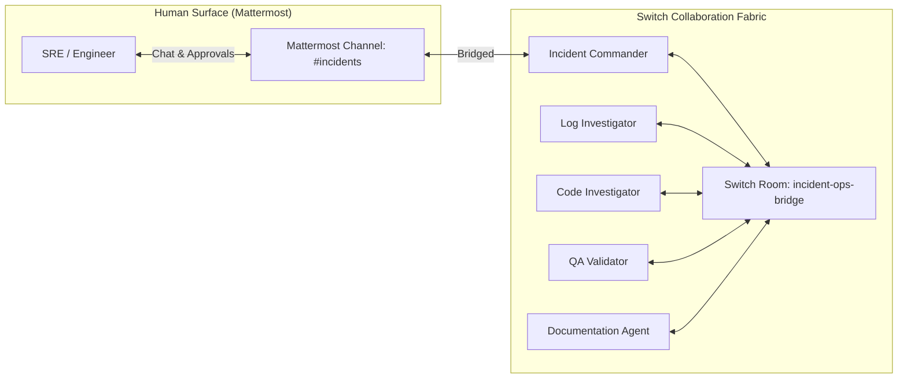

# Switch Collaboration Layer Configuration & Environment Bindings

This document records the verified integration bindings, room configurations, and event handlers for the **Switch** agent collaboration layer in **IncidentOS**, audited and confirmed during Milestone 1.

---

## 1. Verified Switch Runtime Environment

- **Switch Console Version**: `0.31.0` (Native runtime managed by Console)
- **Local Server API Endpoint**: `http://127.0.0.1:60463` (Admin email: `admin@switch.local`)
- **Gateway Endpoint**: `http://127.0.0.1:60462`
- **Database**: PostgreSQL 16 on `127.0.0.1:60465`
- **Execution Machine**: Local host machine (e.g., `machine: "<switch-machine-id>"`)
- **Active Providers**:
  - `antigravity`: Installed (`v1.1.1`), Authenticated (`auth: ok`), binary: `antigravity-acp`.
  - `claude`: Installed (`v2.1.316`), Unauthenticated (`auth: missing`).
  - `codex`, `cursor`, `opencode`: Not installed.
- **Agent Provider Choice**: All IncidentOS agents will run on the verified `antigravity` provider using the Antigravity ACP runtime.

---

## 2. Verified Mattermost Environment & Bridge

- **Mattermost Server Version**: `mattermost-team-edition:11.9.0` running under local Docker Compose.
- **Mattermost Site URL**: `http://localhost:60464`
- **Mattermost Team Slug**: `switch`
- **Human Admin User**: `user` (Linked to Switch admin `admin@switch.local`)
- **Active Switch Bridge ID**: `3c93642d-40a0-4a53-9acf-825eb9b38598` (Default Mattermost Bridge, `can_create_channels: true`)
- **Integration Mechanism**:
  - Switch connects to Mattermost via admin bot credentials and WebSocket stream.
  - Each agent added to a bridged room automatically receives a native Mattermost bot account.
  - Messages sent via `post_message` or `send_targeted_message` in bridged rooms post directly to Mattermost under the agent's bot identity.
  - Mattermost renders standard Markdown (headers, tables, code blocks, bold, links).

---

## 3. Recommended Collaboration Architecture: Model B (Dual-Surface Hybrid)

To ensure high human signal-to-noise ratio while preserving full autonomous collaboration between agents, IncidentOS implements **Model B**:



1. **Human-Facing Channel (`incidents`)**:
   - Bridged Mattermost channel linked to Switch room `incidents`.
   - Participants: Human Engineer (`user`) and `incident-commander`.
   - Purpose: Clean executive alerts, status digests, interactive approval requests, and published postmortems.
2. **Internal Collaboration Room (`incident-ops-bridge`)**:
   - Unbridged / internal Switch room.
   - Participants: All five agents (`incident-commander`, `log-investigator`, `code-investigator`, `qa-validator`, `documentation-agent`).
   - Purpose: Multi-turn technical triage, task delegations via `send_targeted_message`, tool evidence publication (logs, git diffs, test logs), and hypothesis debates.
3. **Room Linkage**:
   - `incident-ops-bridge` is linked to `incidents` via `link_rooms` with label `"human-incident-channel"`.

---

## 4. Agent Specifications & Registration Procedure

All 5 agents are provisioned on the local Switch host machine with provider `antigravity` and `auto_session: true`:

| Agent Name | Work Directory | Primary Responsibility |
|---|---|---|
| `incident-commander` | `~/.switch/agents/localhost-60463/incident-commander` | Fronts Mattermost channel, orchestrates `incident-ops-bridge`, enforces approval gates. |
| `log-investigator` | `~/.switch/agents/localhost-60463/log-investigator` | Consumes FastAPI `/api/tools/logs`, extracts stack traces, isolates error boundaries. |
| `code-investigator` | `~/.switch/agents/localhost-60463/code-investigator` | Consumes FastAPI `/api/tools/git`, blames commits, generates minimal git patch. |
| `qa-validator` | `~/.switch/agents/localhost-60463/qa-validator` | Consumes FastAPI `/api/tools/test`, validates regression failure and post-fix pass. |
| `documentation-agent` | `~/.switch/agents/localhost-60463/documentation-agent` | Unlocked after human approval; aggregates timeline and generates Markdown postmortem. |

### Creation Tool Call Template:
```json
{
  "name": "<agent-name>",
  "machine": "<switch-machine-id>",
  "provider": "antigravity",
  "directory": "~/.switch/agents/localhost-60463/<agent-name>",
  "description": "...",
  "instructions": "...",
  "auto_mode": true,
  "auto_approve": false
}
```

> [!IMPORTANT]
> **Difference Between `auto_mode` and `auto_approve`**:
> - **`auto_mode: true`**: Enables autonomous turn-handling and inter-agent message consumption inside Switch rooms. Maps to ACP `sessionMode: "auto_edit"`, which auto-accepts file edits within workspace boundaries but retains strict approval gates for tool invocations and command execution.
> - **`auto_approve: true`**: Bypass mode. Maps to ACP `sessionMode: "yolo"` (`full-access`), running **every** tool, shell command, and script without asking for permission. This completely dismantles least-privilege containment and is **strictly prohibited** for all IncidentOS agents.

---

## 5. Message Routing & Approval Handling

### Addressing & Dispatch
- Direct agent delegation uses `send_targeted_message(body=..., target_names=["<agent-name>"])`.
- Switch routes targeted messages directly into the agent session via ACP as an addressed turn.
- In Mattermost channel `#incidents`, typing `@incident-commander ...` or using `!assign-agent @incident-commander` directs incoming messages to the Incident Commander.

### Headless ACP Approval Deadlock & Gateway Feasibility (Milestone 4E.4.3)
- **The Operational Deadlock**: Antigravity runs headless via `antigravity-acp`. When specialist agents (`log-investigator`, `code-investigator`, `qa-validator`) run inside unbridged internal Switch rooms (`incident-ops-bridge`), un-whitelisted tool invocations trigger interactive `request.opened` events. Because no human UI exists in unbridged rooms, these requests remain pending indefinitely, deadlocking the agent session turn and blocking subsequent messages.
- **Evaluated Workaround (Automated Gateway)**: Milestone 4E.4.3 investigated deploying a local sidecar gateway connecting to Switch Gateway WebSocket (`ws://127.0.0.1:60462`) to programmatically approve allowlisted IncidentOS tools.
- **Architectural Rejection (ADR-011)**:
  - Switch 0.31.0 strips structured tool provenance (`toolName`, `mcpServer`, `agentId`, and structured arguments) from the `request.opened` event payload.
  - The event exposes only human-facing UI display strings (`title` and truncated `detail`).
  - Relying on title-string regex/matching is vulnerable to command description spoofing (an uncontained shell command could set its description to match an approved MCP tool).
  - Consequently, automated title-parsing gateways are **rejected as unsafe**.
- **Approved Operational Policy**:
  - `auto_approve: false` remains mandatory across all agent configurations.
  - Human review remains the sole authorization mechanism for non-autonomous operations.

### Human Approval Gate
- **Headless ACP Limitation**: Antigravity runs headless via `antigravity-acp`. Native modal UI prompts are skipped/denied by design.
- **MVP Approval Flow**:
  1. `incident-commander` posts the proposed fix (root cause summary, culprit commit, unified diff, test metrics) into `#incidents`.
  2. The prompt requests explicit human confirmation: e.g., *"Reply with `@incident-commander approve` or `!approve` to proceed with remediation closure."*
  3. The human engineer replies directly in the Mattermost channel.
  4. `incident-commander` verifies the human sender (`user`), records the approval token, and triggers `documentation-agent` to publish the postmortem.

---

## 6. Security & Isolation Controls

- **Filesystem Boundaries**: All backend tool operations strictly enforce canonical path checking under `DEMO_WORKSPACE_ROOT` (defaults to `<repo-root>/demo-environment`).
- **Read-Only Investigation**: Log tailing and Git blame are read-only operations. Code modifications operate on temporary, isolated git branches/worktrees.
- **Local Isolation**: All services (FastAPI, Mattermost, Postgres, Switch Core) bind strictly to loopback interfaces (`127.0.0.1`). No public webhooks or open inbound ports are required.
